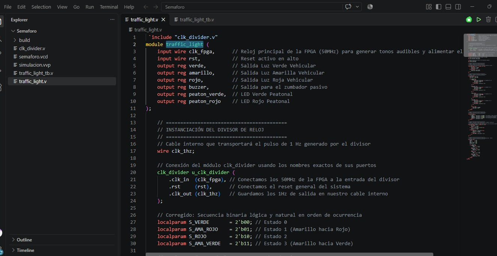
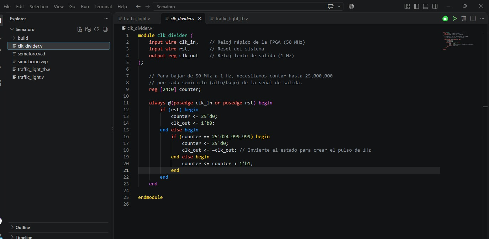
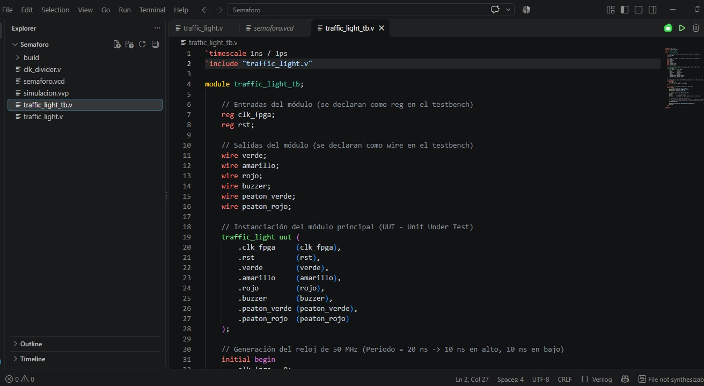

# Tecnicas Digitales G3-E2

Técnicas Digitales - Grupo 3 Equipo 2

## Descripción
Este es el repositorio de la asignatura tecnicas digitales.

## Integrantes

* Ivan Eduardo Beltran Prieto
(https://github.com/ivanedbeltranpr-star)
* Cristian Camilo Romero Contreras
(https://github.com/cristiancaromeroco-dotcom)
* Sebastian Ferney Gutierrez Mondragón
(https://github.com/sebastianfegutierrezmo-ops)

# Informe

Indice:

1. [Contador](#Semaforo)
2. [Simulaciones](#simulaciones)
3. [Evidencias de implementación](#evidencias-de-implementación)
4. [Conclusiones](#conclusiones)

## Documentación del diseño implementado

## 1. Semaforo 

#### 1.1 Descripción

El diseño consiste en la programación en Verilog de una máquina de estados finitos (FSM) que simula el funcionamiento de un semáforo. El sistema controla de manera secuencial y temporizada la transición entre sus tres luces principales: inicia en rojo (detención), cambia a naranja (precaución/transición) y finalmente pasa a verde (avance), asegurando un ciclo lógico, ordenado y sincronizado mediante señales de reloj.

  

## Simulaciones

### Simulación Semaforo

La siguiente imagen muestra la simulación temporal en GTKWave del controlador de semáforo vehicular y peatonal desarrollado en Verilog. En el diagrama de ondas se verifica la sincronización del sistema frente a las señales de reloj y reinicio, evidenciando la conmutación ordenada y mutuamente excluyente entre las luces vehiculares (rojo, amarillo y verde) y su correcta correspondencia con el paso peatonal (peaton_rojo y peaton_verde), garantizando así la seguridad y el cumplimiento lógico de cada estado.

  

## Evidencias De La Implementación

(https://youtu.be/NPtj6FsX_fE)

## Conclusiones

* Validación de la máquina de estados: La simulación en GTKWave confirma que la máquina de estados finitos (FSM) diseñada en Verilog ejecuta de manera precisa y secuencial las transiciones entre los estados del semáforo vehicular (rojo, amarillo y verde), cumpliendo con la lógica temporal establecida.
* Seguridad y exclusión mutua: Se comprobó que las salidas son mutuamente excluyentes y mantienen una sincronización inversa y segura con el semáforo peatonal (peaton_rojo y peaton_verde), evitando estados de conflicto en los que ambos flujos tengan paso simultáneo.
* Sincronización y estabilidad: El sistema responde correctamente a la señal de reinicio (rst) y mantiene sus cambios de estado alineados con los flancos de la señal de reloj (clk), demostrando que el diseño digital es estable y apto para su posterior implementación física en hardware (FPGA).

## Referencias 

* Chu, P. P. (2008). FPGA Prototyping by Verilog Examples: Xilinx Spartan-3 Version. Wiley-Interscience. KFUPM.
* Harris, D. M., & Harris, S. L. (2007). Digital Design and Computer Architecture. Morgan Kaufmann. R-5.

