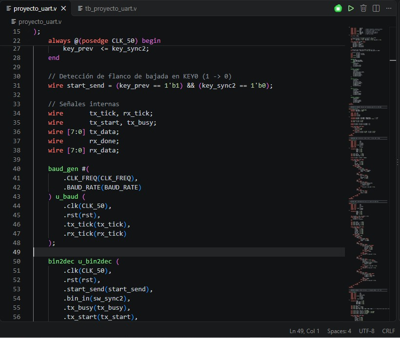
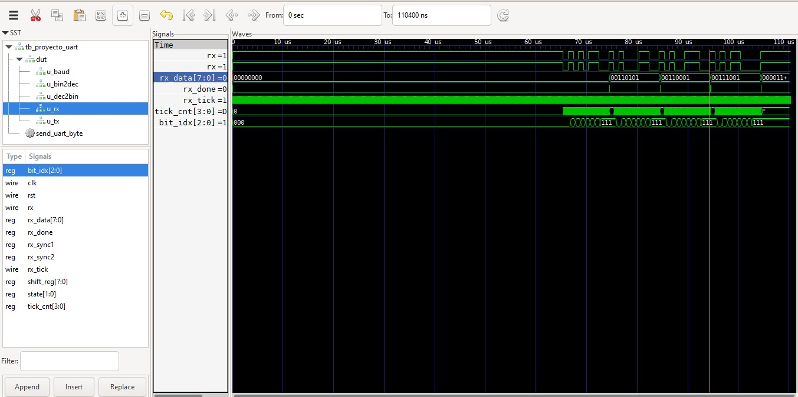

# Tecnicas Digitales G3-E2

Técnicas Digitales - Grupo 3 Equipo 2

## Descripción
Este es el repositorio de la asignatura tecnicas digitales.

## Informe Proyecto Final

## Integrantes

* Ivan Eduardo Beltran Prieto
(https://github.com/ivanedbeltranpr-star)
* Cristian Camilo Romero Contreras
(https://github.com/cristiancaromeroco-dotcom)
* Sebastian Ferney Gutierrez Mondragón
(https://github.com/sebastianfegutierrezmo-ops)

# Informe

Indice:

1. [Sumador de 3 bits](#sumador-de-3-bits)
2. [Display 7 segmentos](#Display-7-segmentos)
3. [Simulaciones](#simulaciones)
4. [Evidencias de implementación](#evidencias-de-implementación)
5. [Conclusiones](#conclusiones)

## Documentación del diseño implementado

## 1. Enlace de Comunicación Serial UART entre FPGA y PC

#### 1.1 Descripción

El laboratorio consiste en el diseño e implementación en Verilog de un enlace de comunicación serial bidireccional (UART) configurado a una velocidad de 9600 baudios (con reloj del sistema de 50 MHz), que permite el intercambio de datos en tiempo real entre una tarjeta FPGA y un computador mediante un conversor USB-TTL y la terminal PuTTY.
El funcionamiento del sistema se divide en dos etapas principales:

1. Recepción de datos (PC \(\rightarrow \) FPGA): Desde la consola de PuTTY se envía un valor numérico hacia la FPGA (a través de la línea GPIO_RX). El módulo procesa la trama serial recibida y refleja dicho número de manera visual encendiendo los LEDs correspondientes en la placa (LEDR[9:0]).

2. Transmisión de datos (FPGA \(\rightarrow \) PC): Mediante la activación manual de los interruptores físicos de la tarjeta (SW[9:0], que representan valores de 0 a 1023) y al presionar el botón de envío (KEY0), el sistema sincroniza las entradas para evitar rebotes o metaestabilidad, detecta el flanco de bajada y transmite el dato serialmente por el pin GPIO_TX, logrando que el número configurado en los pines aparezca directamente en la pantalla de PuTTY.

  

  
  

## Simulaciones

### Enlace de Comunicación Serial UART entre FPGA y PC

La imagen muestra la simulación temporal en GTKWave (testbench tb_proyecto_uart) correspondiente al módulo receptor serial u_rx, encargado de capturar los datos enviados desde el computador (PuTTY) hacia la FPGA.
En el diagrama de ondas se observa el siguiente comportamiento a lo largo de la línea de tiempo (de 0 a 110 us):
* Estado de reposo (0 a ~66 us): La línea de entrada serial rx permanece en nivel lógico alto (1), indicando que no hay transmisión activa, mientras el registro de salida rx_data[7:0] se mantiene inicializado en 00000000.
* Recepción de tramas seriales (~66 us en adelante): Al detectarse el bit de inicio (flanco de bajada en rx), el módulo activa el muestreo sincronizado mediante los pulsos de sobremuestreo (rx_tick) y el contador de ticks (tick_cnt[3:0]).
* Reconstrucción del byte (bit_idx[2:0]): A medida que llegan los bits por la línea rx, el índice bit_idx avanza secuencialmente desde 000 hasta 111 (0 a 7) para almacenar cada bit en el registro de desplazamiento.
* Validación y entrega del dato (rx_data y rx_done): Al completarse cada trama de 8 bits y verificarse el bit de parada, se genera un pulso en rx_done y el dato recibido se actualiza en paralelo en el bus rx_data[7:0]. En la simulación se evidencia la recepción exitosa y consecutiva de los caracteres en código ASCII:
  * 00110101 (equivalente en decimal a 53, carácter ASCII '5').
	* 00110001 (equivalente en decimal a 49, carácter ASCII '1').
	* 00111001 (equivalente en decimal a 57, carácter ASCII '9').
Con esto se comprueba que el módulo receptor decodifica correctamente el número 519 enviado en formato ASCII antes de pasarlo al conversor (u_dec2bin) para ser reflejado en los LEDs de la FPGA.

  

## Evidencias De La Implementación

(https://youtube.com/shorts/LYdSt52K2yE?feature=share)

## Conclusiones 

* Validación del enlace bidireccional UART: Se comprobó satisfactoriamente el diseño e implementación del protocolo de comunicación serial UART en Verilog, logrando una transferencia de datos confiable y en tiempo real entre el computador (terminal PuTTY) y la tarjeta FPGA a una tasa de 9600 baudios.
* Precisión en la recepción y decodificación: Mediante la simulación temporal en GTKWave se verificó que el módulo receptor sincroniza correctamente el muestreo de los bits, reconstruyendo sin errores los caracteres recibidos en formato ASCII (como '5', '1' y '9') para su posterior conversión a binario y visualización exacta en los LEDs de la placa (LEDR[9:0]).
* Integridad en la transmisión desde hardware: Se validó el funcionamiento de la etapa de envío al activar los interruptores físicos (SW[9:0]) y el pulsador de disparo , demostrando que la sincronización de entradas evita rebotes y permite transmitir con éxito el valor numérico hacia la consola de PuTTY.
* Importancia de la sincronización y conversión de formatos: El laboratorio evidenció que, para lograr una comunicación efectiva entre un sistema digital en FPGA y una interfaz de usuario en PC, es indispensable ajustar con exactitud los divisores de frecuencia (generación de baudios) e implementar módulos de conversión (ASCII/decimal a binario y viceversa) que traduzcan la información entre ambos entornos.

## Referecnias
* Chu, P. P. (2008). FPGA Prototyping by Verilog Examples: Xilinx Spartan-3 Version. Wiley-Interscience. KFUPM.
* Harris, D. M., & Harris, S. L. (2007). Digital Design and Computer Architecture. Morgan Kaufmann. R-5.

