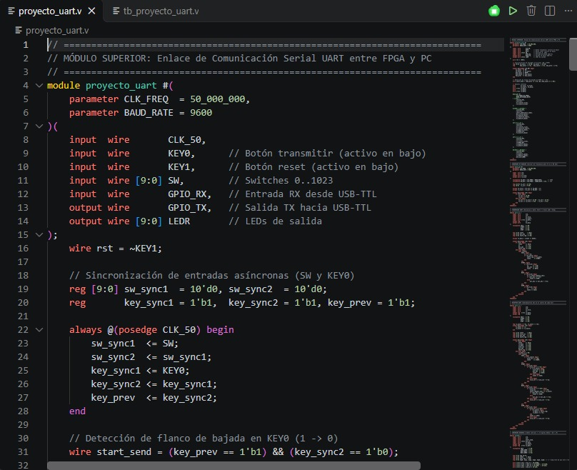
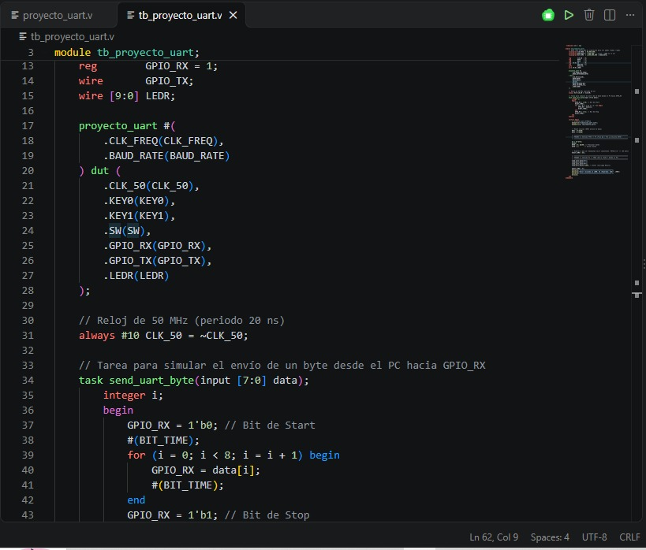
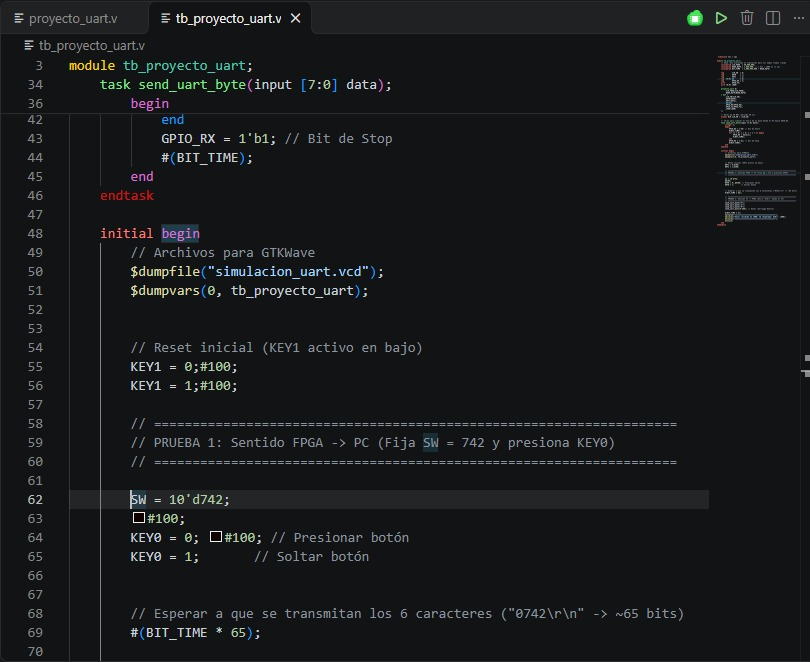

# Tecnicas Digitales G3-E2

Técnicas Digitales - Grupo 3 Equipo 2

## Descripción
Este es el repositorio de la asignatura tecnicas digitales.

## Informe Proyecto Final

## Integrantes

* Ivan Eduardo Beltran Prieto
(https://github.com/ivanedbeltranpr-star)
* Cristian Camilo Romero Contreras
(https://github.com/cristiancaromeroco-dotcom)
* Sebastian Ferney Gutierrez Mondragón
(https://github.com/sebastianfegutierrezmo-ops)

# Informe

Indice:

1. [Sumador de 3 bits](#sumador-de-3-bits)
2. [Display 7 segmentos](#Display-7-segmentos)
3. [Simulaciones](#simulaciones)
4. [Evidencias de implementación](#evidencias-de-implementación)
5. [Conclusiones](#conclusiones)

## Documentación del diseño implementado

## 1. Enlace de Comunicación Serial UART entre FPGA y PC

#### 1.1 Descripción

El laboratorio consiste en el diseño e implementación en Verilog de un enlace de comunicación serial bidireccional (UART) configurado a una velocidad de 9600 baudios (con reloj del sistema de 50 MHz), que permite el intercambio de datos en tiempo real entre una tarjeta FPGA y un computador mediante un conversor USB-TTL y la terminal PuTTY.
El funcionamiento del sistema se divide en dos etapas principales:

1. Recepción de datos (PC \(\rightarrow \) FPGA): Desde la consola de PuTTY se envía un valor numérico hacia la FPGA (a través de la línea GPIO_RX). El módulo procesa la trama serial recibida y refleja dicho número de manera visual encendiendo los LEDs correspondientes en la placa (LEDR[9:0]).

2. Transmisión de datos (FPGA \(\rightarrow \) PC): Mediante la activación manual de los interruptores físicos de la tarjeta (SW[9:0], que representan valores de 0 a 1023) y al presionar el botón de envío (KEY0), el sistema sincroniza las entradas para evitar rebotes o metaestabilidad, detecta el flanco de bajada y transmite el dato serialmente por el pin GPIO_TX, logrando que el número configurado en los pines aparezca directamente en la pantalla de PuTTY.

  

  
  

## Simulaciones

### Enlace de Comunicación Serial UART entre FPGA y PC

La imagen muestra la simulación temporal en GTKWave (testbench tb_proyecto_uart) correspondiente al módulo receptor serial u_rx, encargado de capturar los datos enviados desde el computador (PuTTY) hacia la FPGA.
En el diagrama de ondas se observa el siguiente comportamiento a lo largo de la línea de tiempo (de 0 a 110 us):
* Estado de reposo (0 a ~66 us): La línea de entrada serial rx permanece en nivel lógico alto (1), indicando que no hay transmisión activa, mientras el registro de salida rx_data[7:0] se mantiene inicializado en 00000000.
* Recepción de tramas seriales (~66 us en adelante): Al detectarse el bit de inicio (flanco de bajada en rx), el módulo activa el muestreo sincronizado mediante los pulsos de sobremuestreo (rx_tick) y el contador de ticks (tick_cnt[3:0]).
* Reconstrucción del byte (bit_idx[2:0]): A medida que llegan los bits por la línea rx, el índice bit_idx avanza secuencialmente desde 000 hasta 111 (0 a 7) para almacenar cada bit en el registro de desplazamiento.
* Validación y entrega del dato (rx_data y rx_done): Al completarse cada trama de 8 bits y verificarse el bit de parada, se genera un pulso en rx_done y el dato recibido se actualiza en paralelo en el bus rx_data[7:0]. En la simulación se evidencia la recepción exitosa y consecutiva de los caracteres en código ASCII:
  * 00110101 (equivalente en decimal a 53, carácter ASCII '5').
	* 00110001 (equivalente en decimal a 49, carácter ASCII '1').
	* 00111001 (equivalente en decimal a 57, carácter ASCII '9').
Con esto se comprueba que el módulo receptor decodifica correctamente el número 519 enviado en formato ASCII antes de pasarlo al conversor (u_dec2bin) para ser reflejado en los LEDs de la FPGA.

  

## Evidencias De La Implementación

(https://youtube.com/shorts/LYdSt52K2yE?feature=share)

## 1. Descripción General del Sistema

Este proyecto implementa un sistema de comunicación serial asíncrona bidireccional (*UART) en **Verilog* sobre la FPGA *DE10-Lite, enlazada a un computador mediante un conversor **USB-TTL (3.3 V)* y una terminal serial (*PuTTY*).

El sistema aprovecha los *10 switches (SW9..SW0)* y *10 LEDs (LEDR9..LEDR0)* de la tarjeta para representar números enteros sin signo en el rango de *0 a 1023* (10 bits), operando bajo configuración *9600 baudios, 8-N-1*:

* *Sentido FPGA → PC (Transmisión):* Al fijar un valor binario en SW[9:0] y presionar el pulsador KEY0, la FPGA convierte el número de 10 bits a 4 dígitos decimales en codificación ASCII y los transmite serialmente hacia PuTTY seguidos de un salto de línea (\r\n).
* *Sentido PC → FPGA (Recepción):* Al escribir un número decimal entre 0 y 1023 en PuTTY y presionar Enter, la FPGA recibe cada carácter ASCII, reconstruye su valor binario de 10 bits y lo despliega en los LEDs LEDR[9:0].

 Arquitectura del Diseño y Diagrama de Bloques

text
                           proyecto_uart (50 MHz)
        ┌──────────────────────────────────────────────────────────┐
        │                                                          │
SW[9:0]─┼─►[Sync]─►┌─────────┐   tx_data    ┌─────────┐            │
KEY0 ───┼─►[Edge]─►│ bin2dec ├─────────────►│ uart_tx ├──► GPIO_TX─┼──► RX (USB-TTL)
        │          └─────────┘              └────▲────┘            │
        │                                        │ tx_tick         │
        │                                   ┌────┴────┐            │
        │                                   │baud_gen │            │
        │                                   └────┬────┘            │
        │                                        │ rx_tick (16x)   │
LEDR[9:0]◄─────────┌─────────┐   rx_data    ┌────▼────┐            │
        │          │ dec2bin │◄─────────────┤ uart_rx │◄── GPIO_RX─┼──◄ TX (USB-TTL)
        │          └─────────┘              └─────────┘            │
        └──────────────────────────────────────────────────────────┘

### Descripción de Módulos (proyecto_uart.v)

| Módulo | Función Principal |
| :--- | :--- |
| *proyecto_uart* | Módulo superior (Top-Level). Sincroniza las entradas asíncronas (SW, KEY0) mediante flip-flops en cascada, detecta el flanco de bajada de KEY0 e interconecta los bloques internos. |
| *baud_gen* | Divisor de frecuencia sobre el reloj de 50 MHz. Genera pulsos de habilitación tx_tick (cada 5208 ciclos, 1x) y rx_tick (cada 325 ciclos, sobremuestreo 16x). |
| *uart_tx* | Máquina de estados finitos (IDLE → START → DATA → STOP) que serializa cada byte en formato 8-N-1 (LSB primero). |
| *uart_rx* | Máquina de estados finitos (IDLE → START → DATA → STOP) con sincronizador de 2 etapas. Verifica el bit Start a mitad de período, muestrea los 8 bits de datos en su centro y valida el bit Stop. |
| *bin2dec* | Extrae millares, centenas, decenas y unidades de SW[9:0], los convierte a caracteres ASCII (+ 8'h30) y gestiona el envío secuencial de los 4 dígitos más \r\n. |
| *dec2bin* | Acumula los dígitos ASCII recibidos (acum = acum * 10 + dígito) y actualiza la salida LEDR[9:0] al recibir el carácter Enter (0x0D o 0x0A), saturando valores mayores a 1023. |

## 3. Asignación de Pines (DE10-Lite)

Todos los puertos utilizan el estándar eléctrico *3.3-V LVTTL*:

| Señal Verilog | Pin FPGA | Recurso DE10-Lite / Conexión Externa |
| :--- | :--- | :--- |
| CLK_50 | PIN_P11 | Reloj principal de 50 MHz |
| KEY0 | PIN_B8 | Pulsador derecho (Transmitir, activo en bajo) |
| KEY1 | PIN_A7 | Pulsador izquierdo (Reset, activo en bajo) |
| SW[9:0] | F15, B14, A14, A13, B12, A12, C12, D12, C11, C10 | Interruptores deslizantes (MSB a LSB) |
| LEDR[9:0] | B11, A11, D14, E14, C13, D13, B10, A10, A9, A8 | LEDs rojos indicadores (MSB a LSB) |
| GPIO_TX | PIN_V10 (GPIO[0], Pin 1 JP1) | Conectar al pin *RX* del adaptador USB-TTL |
| GPIO_RX | PIN_W10 (GPIO[1], Pin 2 JP1) | Conectar al pin *TX* del adaptador USB-TTL |
| GND | Pin 12 o Pin 30 de JP1 | Conectar al pin *GND* del adaptador USB-TTL |

> *Advertencia de Hardware:* El adaptador USB-TTL debe operar estrictamente a *3.3 V* para evitar daños en los bancos de E/S del FPGA MAX 10.

---

## 4. Simulación y Estructura del Repositorio

text
├── proyecto_uart.v        # Código fuente RTL completo (Top-level y submódulos)
├── tb_proyecto_uart.v     # Testbench de verificación bidireccional
├── simulacion_uart.vcd    # Archivo de volcado de ondas para GTKWave
└── README.md              # Documentación del proyecto

### Ejecución de la Simulación (Icarus Verilog + GTKWave)
bash
iverilog -o sim.out proyecto_uart.v tb_proyecto_uart.v
vvp sim.out
gtkwave simulacion_uart.vcd

En el testbench se validan ambos sentidos de operación:
1. *FPGA → PC:* Con SW = 742 (0x2E6), al pulsar KEY0 se generan 6 tramas UART en GPIO_TX correspondientes a "0742\r\n".
2. *PC → FPGA:* Se inyectan serialmente por GPIO_RX los caracteres "519\r", actualizando LEDR al valor binario 10'b1000000111 (519 decimal / 0x207).

## 5. Preguntas de Análisis

### 1. ¿Por qué un solo byte UART no alcanza para representar los números 0–1023, y cómo lo resuelve su diseño?
En formato 8-N-1, una trama UART transporta *8 bits, lo que cubre únicamente el rango de **0 a 255* ($2^8 = 256$ valores). Representar los *1024* valores posibles de los 10 switches/LEDs (*0 a 1023) requiere **10 bits* ($2^{10}$). El diseño resuelve esta limitación transmitiendo el número como texto en codificación *ASCII*:
* En transmisión (bin2dec), el número de 10 bits se descompone en 4 dígitos decimales (millares, centenas, decenas y unidades) y a cada uno se le suma 0x30 para enviarlo como un byte ASCII independiente, seguido de \r\n.
* En recepción (dec2bin), se reciben los bytes ASCII de cada dígito y se acumulan aritméticamente (valor = valor * 10 + dígito) hasta detectar la tecla Enter (0x0D), actualizando los 10 bits de los LEDs.

### 2. Calcule el número de cuentas del generador de baudios para 9600 baudios con el reloj de 50 MHz.
* *Para el transmisor (tx_tick, 1 cuenta por bit):*
  $$N_{TX} = \frac{f_{clk}}{\text{baud}} = \frac{50\,000\,000\text{ Hz}}{9600\text{ bps}} \approx 5208\text{ cuentas}$$
* *Para el receptor (rx_tick, sobremuestreo 16x por bit):*
  $$N_{RX} = \frac{f_{clk}}{\text{baud} \times 16} = \frac{50\,000\,000\text{ Hz}}{9600 \times 16} \approx 325\text{ cuentas}$$
### 3. ¿Por qué el receptor es más complejo que el transmisor?
Porque UART es un protocolo *asíncrono* sin señal de reloj compartida. Mientras el transmisor (uart_tx) únicamente desplaza bits según su propio contador local, el receptor (uart_rx) debe detectar de forma autónoma el flanco de bajada del bit Start, verificar que no sea un pulso espurio por ruido a mitad del bit Start (cuenta 7), muestrear cada bit de datos exactamente en el *centro* del intervalo (cada 16 ticks) para evitar leer zonas inestables de transición, y validar el bit de Stop.

### 4. ¿Por qué se detecta el flanco del botón y no su nivel para transmitir?
Debido a que la FPGA opera a *50 MHz* (período de 20 ns), una pulsación manual dura millones de ciclos de reloj. Si el envío dependiera del nivel bajo (KEY0 == 0), el transmisor enviaría decenas o cientos de tramas repetidas mientras se mantiene presionado el botón. Al usar un detector de flanco de bajada (key_prev && !key_sync2), se genera un pulso de un único ciclo de reloj que dispara exactamente *una transmisión por pulsación*.

### 5. ¿Qué es un error de trama (framing error) y cómo lo detectaría el receptor?
Un framing error ocurre cuando el receptor no detecta el *bit de parada (*Stop) en nivel lógico alto (1)** al finalizar la trama, lo que indica desincronización, ruido en el canal o discrepancia en la velocidad en baudios. El receptor lo detecta en el estado STOP en el tick de muestreo central (tick_cnt == 15): si rx_sync2 == 1'b0, la trama se considera inválida, se descarta el byte recibido (sin activar rx_done) y se puede activar una bandera de error.

### 6. ¿Por qué es necesario sincronizar la línea RX antes de usarla en la FSM?
La señal RX proviene de un dispositivo externo cuyo reloj es independiente al de la FPGA. Si RX cambia de estado cerca del flanco activo del reloj de 50 MHz, los flip-flops de la FSM pueden entrar en *metaestabilidad*, provocando fallos lógicos impredecibles. Al pasar RX por un sincronizador de dos flip-flops en cascada (rx_sync1 y rx_sync2), se garantiza una señal estable y sincronizada con el dominio de reloj de la FPGA antes de evaluarla en la máquina de estados.

### 7. ¿Qué diferencia habría entre enviar el número en binario crudo y enviarlo como texto ASCII?
* *Texto ASCII (implementado):* Utiliza 4 a 6 bytes por número, pero permite visualizar y escribir los valores directamente en una terminal estándar como PuTTY sin conversión manual, además de facilitar la delimitación del final de cada número mediante caracteres de control reservados (Enter / 0x0D).

## Conclusiones 

* Validación del enlace bidireccional UART: Se comprobó satisfactoriamente el diseño e implementación del protocolo de comunicación serial UART en Verilog, logrando una transferencia de datos confiable y en tiempo real entre el computador (terminal PuTTY) y la tarjeta FPGA a una tasa de 9600 baudios.
* Precisión en la recepción y decodificación: Mediante la simulación temporal en GTKWave se verificó que el módulo receptor sincroniza correctamente el muestreo de los bits, reconstruyendo sin errores los caracteres recibidos en formato ASCII (como '5', '1' y '9') para su posterior conversión a binario y visualización exacta en los LEDs de la placa (LEDR[9:0]).
* Integridad en la transmisión desde hardware: Se validó el funcionamiento de la etapa de envío al activar los interruptores físicos (SW[9:0]) y el pulsador de disparo , demostrando que la sincronización de entradas evita rebotes y permite transmitir con éxito el valor numérico hacia la consola de PuTTY.
* Importancia de la sincronización y conversión de formatos: El laboratorio evidenció que, para lograr una comunicación efectiva entre un sistema digital en FPGA y una interfaz de usuario en PC, es indispensable ajustar con exactitud los divisores de frecuencia (generación de baudios) e implementar módulos de conversión (ASCII/decimal a binario y viceversa) que traduzcan la información entre ambos entornos.

## Referecnias
* Chu, P. P. (2008). FPGA Prototyping by Verilog Examples: Xilinx Spartan-3 Version. Wiley-Interscience. KFUPM.
* Harris, D. M., & Harris, S. L. (2007). Digital Design and Computer Architecture. Morgan Kaufmann. R-5.

