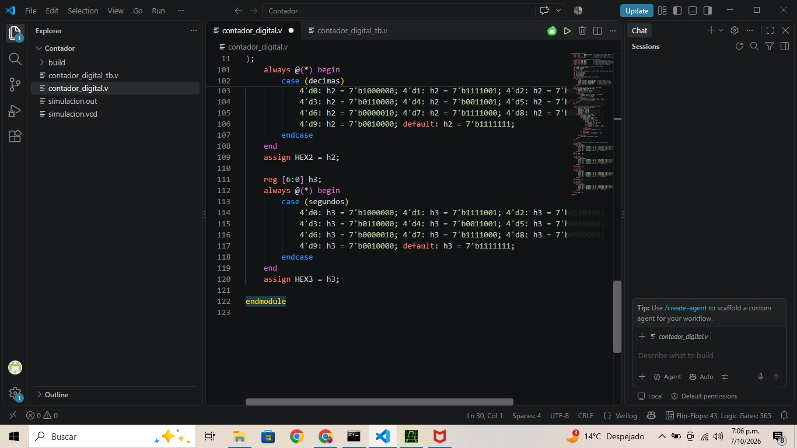
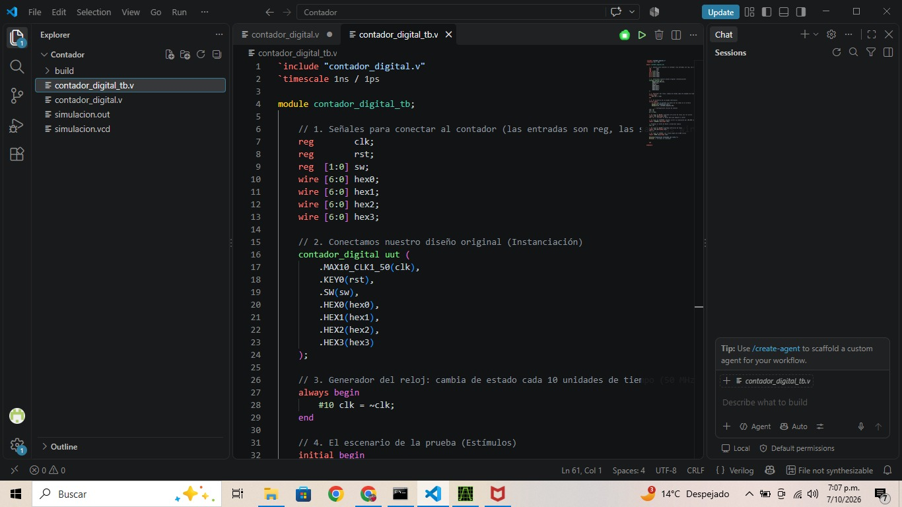
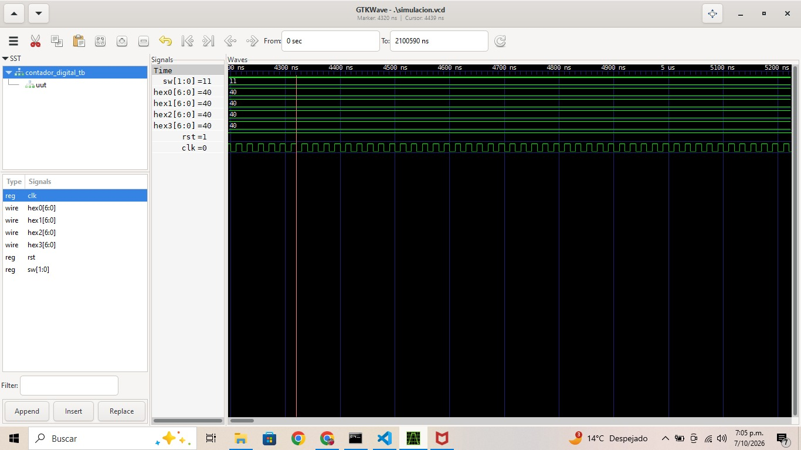

# Tecnicas Digitales G3-E2

Técnicas Digitales - Grupo 3 Equipo 2

## Descripción
Este es el repositorio de la asignatura tecnicas digitales.

## Integrantes

* Ivan Eduardo Beltran Prieto
(https://github.com/ivanedbeltranpr-star)
* Cristian Camilo Romero Contreras
(https://github.com/cristiancaromeroco-dotcom)
* Sebastian Ferney Gutierrez Mondragón
(https://github.com/sebastianfegutierrezmo-ops)

# Informe

Indice:

1. [Contador](#sumador-de-3-bits)
2. [Simulaciones](#simulaciones)
3. [Evidencias de implementación](#evidencias-de-implementación)
4. [Conclusiones](#conclusiones)

## Documentación del diseño implementado

## 1. Contador

#### 1.1 Descripción

* Módulo Principal (contador_digital.v):
Se encarga de la decodificación de datos. Utiliza bloques combinacionales always y estructuras case para traducir los valores numéricos binarios a un vector de 7 bits. La asignación física hacia la FPGA se realiza mediante la instrucción assign. El display opera bajo la configuración de ánodo común (lógica inversa), donde un 0 lógico enciende el segmento y un 1 lo apaga.
* Banco de Pruebas (contador_digital_tb.v):
Es un entorno de simulación no sintetizable (testbench) creado para verificar el funcionamiento del circuito. Define las entradas como reg para controlar sus estados y las salidas como wire. Instancia el módulo principal como UUT (Unidad Bajo Prueba), genera una señal de reloj periódica invirtiendo su estado cada 9 unidades de tiempo y utiliza un bloque initial para aplicar los estímulos de reinicio y conteo.

  

## Simulaciones

### Simulación Contador

La imagen muestra los resultados de la simulación temporal del banco de pruebas (contador_digital_tb), donde se verifica el correcto comportamiento del sistema:
* Estado de Reset Activo (rst = 1): Al inicio de la simulación, la señal de reinicio se encuentra en alto. Esto fuerza al sistema a mantenerse en su estado inicial decorativo o de borrado.
* Señal de Reloj (clk): Se observa la oscilación constante y periódica de la señal de reloj que sincroniza los cambios en el circuito cada vez que se libere el reset.

## Evidencias De La Implementación

(https://youtu.be/bvdPz0zKn5I)

## Conclusiones

* Validación del Diseño: La simulación en GTKWave demuestra el correcto funcionamiento lógico de la arquitectura modular en Verilog, asegurando que las señales respondan según lo programado antes de la implementación física.
* Efectividad del Reset: Se comprobó que la señal de reinicio (rst = 1) inicializa correctamente el sistema de forma síncrona, forzando a todos los displays a mostrar el número cero (40 hexadecimal).
* Compatibilidad de Hardware: El uso del código 40 hexadecimal para representar el cero confirma la correcta implementación de la lógica inversa, indispensable para el funcionamiento de displays de ánodo común en la tarjeta FPGA.

## Referencias 

* Chu, P. P. (2008). FPGA Prototyping by Verilog Examples: Xilinx Spartan-3 Version. Wiley-Interscience. KFUPM.
* Harris, D. M., & Harris, S. L. (2007). Digital Design and Computer Architecture. Morgan Kaufmann. R-5.

